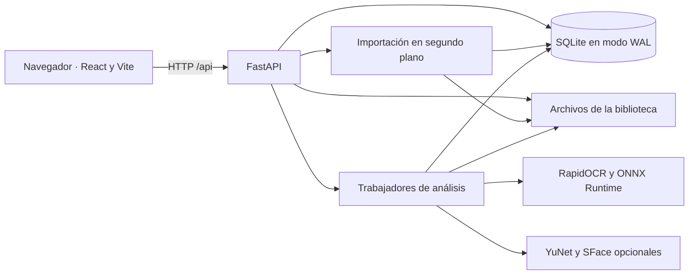

# Arquitectura

RaceFinder se ejecuta en un solo equipo. El navegador presenta la interfaz y el proceso Python mantiene la biblioteca, sirve archivos y ejecuta los modelos locales.

Con `pnpm start`, FastAPI sirve la interfaz compilada y la API desde el mismo origen. Con `pnpm run dev`, Vite sirve la interfaz y reenvía `/api` al proceso FastAPI. El iniciador prepara `backend/.venv`, busca puertos libres y configura el entorno de los procesos. En desarrollo reinicia el proceso Python cuando detecta cambios en sus archivos fuente. [Arranque y configuración](OPERATIONS.md)

## Mapa del repositorio

| Ruta | Responsabilidad |
| --- | --- |
| [scripts/dev.mjs](../scripts/dev.mjs) | Arranque, instalación de requisitos, selección de puertos y ciclo de vida de procesos. |
| [backend/app/main.py](../backend/app/main.py) | API, validación, consultas, exportación y composición de componentes. |
| [backend/app/db.py](../backend/app/db.py), [catalog.py](../backend/app/catalog.py) | Esquema, migraciones, transacciones y asociaciones de álbumes. |
| [backend/app/importer.py](../backend/app/importer.py), [imaging.py](../backend/app/imaging.py) | Importación desde disco, huellas, validación y derivados de imagen. |
| [backend/app/worker.py](../backend/app/worker.py), [bibs.py](../backend/app/bibs.py), [faces.py](../backend/app/faces.py) | Cola, OCR, detección y búsqueda facial. |
| [backend/app/hardware.py](../backend/app/hardware.py), [device.py](../backend/app/device.py) | Capacidad del equipo y selección de proveedores de cálculo. |
| [frontend/src](../frontend/src) | Interfaz, catálogo, visor, ajustes, evaluación y cliente HTTP. |
| [backend/tests](../backend/tests), [frontend/e2e](../frontend/e2e), [backend/tools](../backend/tools) | Pruebas y utilidades de evaluación y rendimiento. |

## De la importación al análisis

1. La importación por navegador envía archivos por lotes a la API. La importación por carpeta recorre el árbol en el servidor y puede enlazar un original en el mismo volumen. Usa copia cuando el enlace falla.
2. La aplicación valida formato y tamaño con Pillow, usa SHA-256 para una identidad estable y guarda el original en `originals/<prefijo>/<sha256>.<ext>`. Una huella rápida de tamaño y los primeros 64 KiB permite omitir archivos ya vistos al reanudar una carga web. El nombre original se conserva como metadato.
3. Al registrar la foto se genera una miniatura y se pone el análisis en cola. Las vistas previas y los recortes se crean cuando hacen falta.
4. Los trabajadores reclaman fotos mediante una actualización atómica en SQLite. Cada foto conserva su estado e intentos de OCR y caras. Los trabajos interrumpidos en `processing` vuelven a `pending` al reiniciar. La pausa deja terminar el trabajo en curso y detiene nuevas asignaciones.
5. Cada trabajador analiza una foto, guarda resultados y actualiza su estado. Al repetir OCR se sustituyen las detecciones automáticas, conservando las decisiones humanas.

Los estados de catálogo y análisis sobreviven a los reinicios. La pausa y el progreso detallado de la importación viven en memoria. Tras reiniciar una importación, los archivos que ya quedaron registrados se pueden deduplicar.

## Dorsales y caras

El OCR lee la imagen reducida y, según el modo y el tamaño, zonas solapadas de la foto. Normaliza confusiones de caracteres en tokens plausibles, filtra cajas y fusiona detecciones solapadas. La biblioteca conserva coordenadas sobre la imagen orientada, número, texto bruto, confianza y revisión. Escenas con relojes o carteles pueden producir falsos positivos. La interfaz permite revisar el recorte y confirmar, descartar o añadir un dorsal.

El análisis facial requiere activación con consentimiento. YuNet detecta caras y SFace produce los vectores de similitud. Para sugerir referencias se usa la geometría de la caja facial respecto al dorsal, la confianza de lectura y la coherencia entre referencias. El usuario puede corregir esa selección. El buscador compara vectores y devuelve similitud coseno. El conjunto de fotos devuelto se puede limitar a un álbum. [Uso y privacidad](USER_GUIDE.md#buscar-por-cara) · [Modelos y licencias](../THIRD_PARTY_NOTICES.md)

## Datos y ámbitos

| Tablas | Contenido |
| --- | --- |
| `photos` | Identidad por hash, nombre, dimensiones, favorito, tipo de archivo y estados del análisis. |
| `albums` y `album_photos` | Relación de muchos a muchos y rango opcional por álbum. |
| `bib_detections` | Lecturas automáticas, manuales y sus revisiones. |
| `faces` | Detecciones, cajas, calidad y vectores faciales asociados a una foto. |
| `settings` | Preferencias persistentes de la biblioteca y fecha del consentimiento facial. |
| `gt_labels` y `eval_runs` | Etiquetas de referencia e historial de evaluación. |

Cada original se almacena una vez por contenido y puede aparecer en varios álbumes. El rango de dorsal filtra las consultas de dorsales. Los dorsales añadidos a mano pueden quedar fuera del rango. Al borrar un álbum se eliminan sus asociaciones. Al borrar una foto se eliminan sus asociaciones y datos derivados de catálogo. [Datos y restauración](OPERATIONS.md#datos-y-copias-de-seguridad)

## Perímetro local

El iniciador enlaza FastAPI a `127.0.0.1`. FastAPI valida el host y configura CORS para los orígenes locales previstos. El modo de red expone Vite como entrada en una LAN y reenvía solicitudes a la API local. RaceFinder carece de autenticación, separación por usuario y control de acceso por álbum.

La instalación inicial obtiene dependencias y puede obtener paquetes de GPU. La función facial descarga los modelos oficiales si no están instalados y verifica su hash. Después de preparar el entorno y los modelos, el OCR y la búsqueda facial se ejecutan en el equipo sobre la biblioteca local. [API local](API.md) · [Acceso desde otro dispositivo](OPERATIONS.md#acceder-desde-otro-dispositivo)
