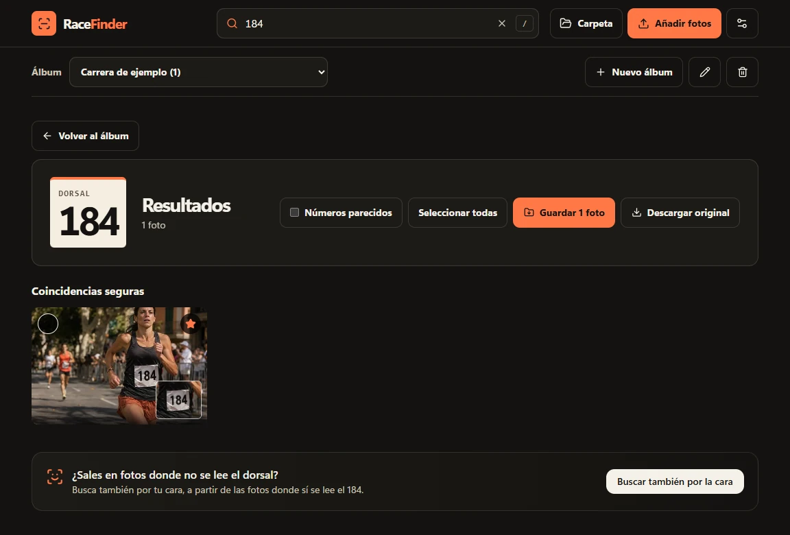

# Guía de uso de RaceFinder

Sigue esta guía después del [primer arranque](../README.md#primer-arranque-en-windows). Los nombres en negrita corresponden a controles de la interfaz.

## Importar fotos

| Acción | Cuándo usarla |
| --- | --- |
| **Carpeta** | Para una carrera guardada en el equipo que ejecuta RaceFinder. Recorre las subcarpetas y almacena los archivos mediante enlaces duros cuando el disco lo permite, o mediante copias. |
| **Añadir fotos** | Para seleccionar archivos concretos desde el navegador. |
| Arrastrar fotos o carpetas | Para añadirlas a la vista actual. Si hay un álbum activo, la importación las asigna a ese álbum. |

Los formatos admitidos son JPG, JPEG, PNG y WebP. Si falta espacio o hay archivos dañados, el panel de importación muestra los rechazados y sus detalles. Al cancelar una importación de carpeta, las fotos ya incorporadas se conservan. Puedes seleccionar la misma carpeta para continuar.

La cabecera muestra el estado del análisis. **Pausar análisis** deja que se terminen las fotos en curso y conserva las pendientes. **Reanudar análisis** continúa la cola. Puedes buscar antes de que termine.

## Organizar varias carreras

1. Pulsa **Nuevo álbum**, ponle un nombre y, si lo conoces, indica el rango de dorsales del evento. Deja ambos límites vacíos para heredar el rango general.
2. Selecciona el álbum antes de importar. Para añadir fotos existentes, márcalas y elige **Organizar selección en álbumes**. Una misma foto puede estar en varios álbumes con un único original en la biblioteca.
3. Usa el selector de la parte superior para cambiar de carrera o volver a **Toda la biblioteca**. El álbum activo acota la galería, el índice y las búsquedas por dorsal o cara. Puedes guardar la dirección de una búsqueda para volver a ella en la misma biblioteca.

**Editar álbum** cambia el nombre o el rango. **Quitar del álbum actual** retira la pertenencia de las fotos seleccionadas. **Eliminar álbum** retira el álbum y deja sus fotos en la biblioteca. **Quitar de RaceFinder** elimina del catálogo las fotos seleccionadas y sus pertenencias en todos los álbumes.

## Buscar y revisar dorsales

Escribe entre uno y cinco dígitos en **Buscar por dorsal** y pulsa **Enter**, o elige un número de **Dorsales encontrados**. La búsqueda distingue estos resultados.

*Captura de RaceFinder con la foto ilustrativa del proyecto.*

| Resultado | Qué indica |
| --- | --- |
| **Coincidencias seguras** | El número coincide y la lectura supera el umbral de confianza, o el dorsal fue confirmado o añadido manualmente. |
| **Por revisar** | Coincidencia exacta con confianza baja, o diferencia de un dígito si está activado **Números parecidos**. |
| **Por parecido facial** | Otra foto recuperada al comparar caras de referencia. Revisa visualmente qué persona aparece. |

El recorte de un dorsal automático permite comprobar lo que leyó el motor. Abre la foto para ampliar, mostrar u ocultar las marcas, confirmar o descartar una lectura y añadir un dorsal que falte. Descartar un dorsal conserva la foto.

En la galería, también puedes buscar por nombre de archivo, ordenar por importación o nombre y filtrar por **Favoritas**, **Por revisar**, **Con dorsal**, **Sin dorsal leído** y estados del análisis. Usa la estrella de la miniatura o del visor para marcar una favorita, o la de la barra inferior para aplicar el cambio a toda la selección.

## Buscar por cara

1. Busca primero un dorsal. Con resultados disponibles, elige **Buscar también por la cara**.
2. Lee el aviso y activa la función solo cuando tengas autorización para procesar y buscar esas caras. El primer análisis descarga los modelos y después procesa la biblioteca en segundo plano.
3. En **Tu cara en otras fotos**, comprueba las referencias y desmarca las que correspondan a otras personas. Revisa **Por parecido facial** antes de guardar. Las fotos respaldadas por ambos métodos se marcan **Dorsal + cara**.

El parecido es una puntuación de similitud. La calidad de la referencia, el ángulo, la distancia y las oclusiones pueden cambiar los resultados.

La función viene desactivada. **Ajustes → Búsqueda por cara → Desactivar** conserva el índice para reutilizarlo más adelante. **Borrar todos los datos faciales** elimina los vectores y los recortes faciales gestionados por RaceFinder y desactiva la función. Las fotos, sus vistas previas y los dorsales siguen disponibles. Guarda y trata las copias de la biblioteca con el mismo cuidado que el original. [Datos locales y copias de seguridad](OPERATIONS.md#datos-y-copias-de-seguridad)

## Seleccionar y exportar

- Marca cada foto con el círculo de su miniatura. Usa `Mayús` al seleccionar para extender un rango entre dos fotos de la lista.
- **Seleccionar todas** en la galería incluye todo el filtro, incluso fotos que aún no se han cargado en pantalla, hasta 20.000 por operación. En una búsqueda por dorsal, selecciona todas las coincidencias mostradas, incluidas las dudosas y las de cara.
- En los resultados, **Guardar N fotos** y **ZIP** usan las coincidencias seguras cuando las hay. Para incluir fotos dudosas, de cara o una selección concreta, marca esas fotos y usa la barra inferior.
- **Guardar selección en carpeta** copia a una carpeta del equipo que ejecuta RaceFinder. Desde una búsqueda por dorsal se usa una subcarpeta como `dorsal-184`. Si dos archivos tienen el mismo nombre y distinto contenido, RaceFinder elige un nombre con sufijo. Si ya existe una copia idéntica, la omite.
- **Descargar selección** (botón **ZIP** en la barra inferior) guarda en el navegador un original si hay una foto, o un ZIP con los originales si hay varias.
- **Catálogo CSV** exporta el filtro actual. Incluye nombre de archivo, álbum activo, dorsales, favorita, estado del análisis y fecha de importación en UTC. Sirve para consultar el inventario en una hoja de cálculo.

## Ajustes y atajos

| Ajuste | Efecto |
| --- | --- |
| **Rápido** | Lee la imagen completa en una pasada. |
| **Equilibrado** | Revisa por zonas las fotos grandes si la pasada global no encontró un dorsal. Es el ajuste inicial. |
| **A fondo** | Revisa por zonas las fotos grandes aun cuando la pasada global ya encontró un dorsal. |
| **Rango global de dorsales** | Filtra las lecturas que se muestran en la biblioteca y en los álbumes sin rango propio. Admite los dorsales añadidos manualmente fuera del rango. |
| **Volver a leer todas las fotos** | Repite el OCR con el modo actual y conserva las correcciones manuales. |
| **Eliminar todas las fotos** | Quita fotos y derivados de la biblioteca activa con la confirmación `ELIMINAR`. Conserva los archivos de origen externos, los ajustes y los álbumes, que quedan vacíos. |

| Atajo | Acción |
| --- | --- |
| `/` | Enfocar la búsqueda de dorsal. |
| `Esc` | Borrar la búsqueda mientras el campo tiene el foco, cerrar el visor o salir primero del zoom. |
| `←` / `→` | Foto anterior o siguiente en el visor. |
| `Z`, clic en la foto o botón de zoom | Alternar entre la vista ajustada y el tamaño real. |
| `B` | Mostrar u ocultar las marcas del dorsal. |
| `S` | Marcar o quitar la foto del visor de la selección. |
| `D` | Descargar el original abierto. |

Si el catálogo no se actualiza o no aparece el selector de carpetas, consulta [solución de problemas](OPERATIONS.md#solución-de-problemas).
